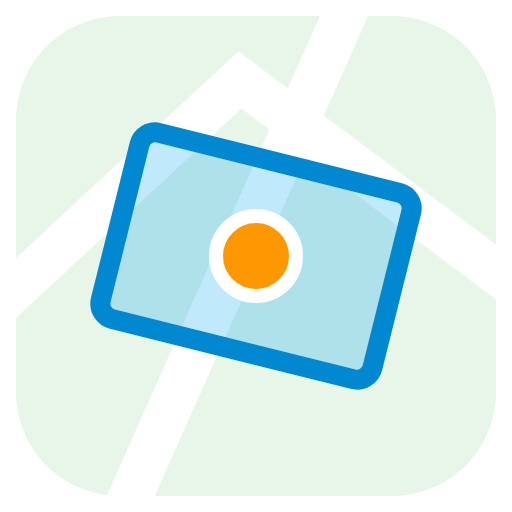

# Box Zones

**Rectangle and polygon zones for Home Assistant.** Draw boxes on a map, as
rectangles you can turn to any angle or as polygons that follow any outline,
and see which box your car or phone is in.

Home Assistant's own zones are always circles. A circle is a bad fit for a
parking spot, a driveway or one side of a street. Box Zones lets you draw a box
instead: a **rectangle** for a parking spot, or a **polygon** for an L-shaped
driveway or a plot with a slanted boundary.

## Install

1. **Add it to HACS:**
   [](https://my.home-assistant.io/redirect/hacs_repository/?owner=Palleri&repository=HomeAssistant&category=integration)
   Press **Download**, then **restart Home Assistant**.
2. **Set it up:**
   [](https://my.home-assistant.io/redirect/config_flow_start/?domain=box_zones)
   Pick the trackers to follow, for example your car.
3. **Draw a box:** open **Box Zones** in the sidebar and press **Add rectangle**
   or **Add polygon**. For a rectangle, drag inside it to move it, the corners
   and side dots to resize it, and its edge to turn it. For a polygon, tap the
   map at each corner (see [Drawing a polygon](#drawing-a-polygon)). Give the
   box a name and press **Save**.

That's it.

<details>
<summary>Without the buttons</summary>

- HACS → ⋮ → **Custom repositories** → add `https://github.com/Palleri/HomeAssistant`
  as type **Integration** → find **Box Zones** → **Download** → restart.
- Settings → Devices & services → **Add integration** → **Box Zones**.
- Manual install: copy `custom_components/box_zones` to
  `/config/custom_components/box_zones` and restart.

</details>

## Drawing a polygon

Press **Add polygon** and tap the map once for each corner, going round the
place in order. The outline grows as you tap. You can still pan and zoom while
drawing: a tap that moves the map places no corner.

- **Close the outline** by tapping the first corner again, or press **Done**.
- **Undo** removes the last corner; **Cancel** (or Escape) throws the polygon
  away.
- **Save** works once the outline is closed with at least 3 corners.

To change a saved polygon, tap it on the map or in the list:

- drag a corner to move it;
- drag the dot in the middle of a side to add a corner there;
- tap a corner and press **Remove corner**, or right-click it, to remove it
  (a polygon keeps at least 3 corners);
- drag inside the polygon, or on a side, to move the whole polygon.

A polygon may be concave (an L or U shape) but its outline must not cross
itself: a crossing outline turns red and dashed, the page says "The outline
crosses itself", and **Save** stays off until you fix it. A polygon has 3 to
100 corners, and like a rectangle it must be at least 4 m² and at most 50 km
across; an outline that breaks one of these rules is shown the same way.

## What you get

For every tracker you follow, Box Zones adds a location entity next to it:

| Your tracker | Box Zones entity |
|---|---|
| `device_tracker.car` | `device_tracker.car_box_zones` |

The entity shows:

- **the box name** when the tracker is inside a box, for example `Parking`
- otherwise exactly what a normal tracker shows: **Home**, **Away**, or the
  name of one of your normal zones

It works anywhere a tracker works: maps, history, and you can even add it to a
**person**.

Every box also gets its own box entity, for example `sensor.box_zones_parking`.
Its state is how many followed trackers are inside the box, and the
`trackers` attribute names them. Other attributes:

| Attribute | Meaning |
|---|---|
| `shape` | `rectangle` or `polygon` |
| `area_m2` | the box's area in square metres |
| `center_latitude`, `center_longitude` | a point inside the box (where its name is shown on the map) |
| `width_m`, `height_m`, `rotation_deg` | rectangles only: size and turn |
| `points` | polygons only: the corners as `[latitude, longitude]` pairs (not stored in history) |

## Use it in an automation

Use a **State** trigger on the Box Zones entity:

```yaml
triggers:
  - trigger: state
    entity_id: device_tracker.car_box_zones
    to: Parking        # the car arrives in the box called "Parking"
```

To trigger when the car leaves, use `from: Parking` instead.

> Home Assistant's **Zone** trigger only knows round zones, so your boxes don't
> show up there. Use the State trigger above, or a State trigger on the box's
> own entity (`sensor.box_zones_parking` going above 0).

## Good to know

- **Overlaps:** the smallest area wins, between boxes and also between a box
  and a normal round zone (the same rule Home Assistant uses for zones). A
  "Driveway" box inside your Home zone shows "Driveway"; a big
  "Neighbourhood" box around your home shows "Home" when you're home.
- **Zone conditions keep working:** "car is in Home" is still true while the
  car is in a box inside your Home zone.
- **Duplicate:** open a rectangle and press **Duplicate** to get a copy of the
  same size and turn right next to it (handy for a row of parking spots).
- **Rectangle only:** Duplicate, turning and the exact size fields are for
  rectangles. A box keeps the shape it was made with; to change shape, draw a
  new box.
- **Same name, more boxes:** several boxes can share one name, for example two
  spots that both count as `Parking`.
- **More trackers:** one Box Zones follows as many trackers as you like. Add
  one with **Add tracker** on Settings → Devices & services → Box Zones, or
  with **Change** under **Followed trackers** on the Box Zones page. To stop
  following one, delete it from the integration's page or untick it there.
- **Map:** the background map comes from OpenStreetMap; the layer button on
  the map switches to satellite images (Esri), which helps when drawing
  parking spots. Everything else runs locally in Home Assistant.
- The Box Zones page is for admins only.
- Your boxes are stored in `/config/.storage/box_zones.zones` and are part of
  normal Home Assistant backups.
- **Going back to 0.3.x:** once 0.4.0 has saved your boxes, the file is in
  a newer format. If you then go back to 0.3.x, Box Zones refuses to load
  instead of dropping your polygons. Upgrading again brings all boxes back.

## Development

```bash
pip install -r requirements_test.txt
pip install "$(python scripts/frontend_requirement.py)"
pytest
node --test tests/js/*.test.mjs
```

`tests/js/touch.test.mjs` drags a finger across the map in a real browser and is
skipped unless Playwright with Chromium is installed
(`npm i playwright && npx playwright install chromium`).

The box maths exists twice, in `geometry.py` (for the entities) and
`frontend/geo.js` (for the map). A test checks that they agree.

## License

MIT, see [LICENSE](LICENSE). The bundled map library
[Leaflet](https://leafletjs.com) has its own BSD-2-Clause license in
`custom_components/box_zones/frontend/leaflet/LICENSE`.

## Releasing

Change `version` in `custom_components/box_zones/manifest.json` and `VERSION`
in `const.py` (a test checks they match), then merge to `main`. The Release
workflow creates the GitHub release, for example `v0.1.2`, and HACS offers it
as an update.
